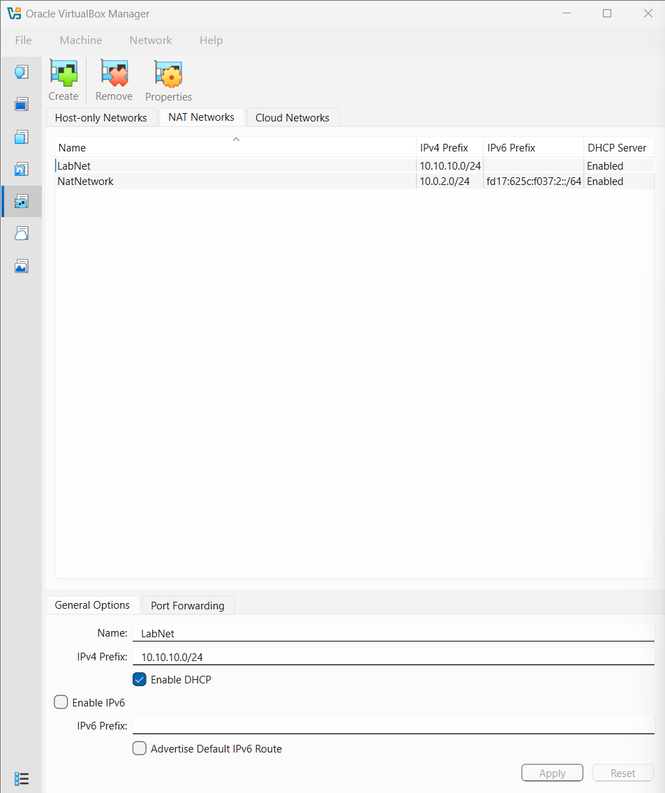
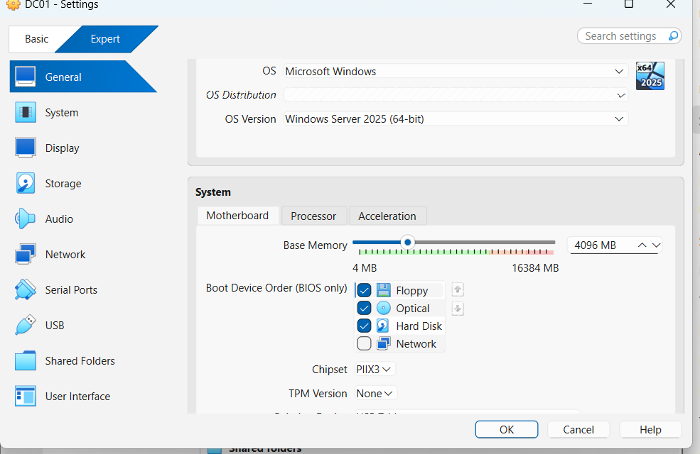
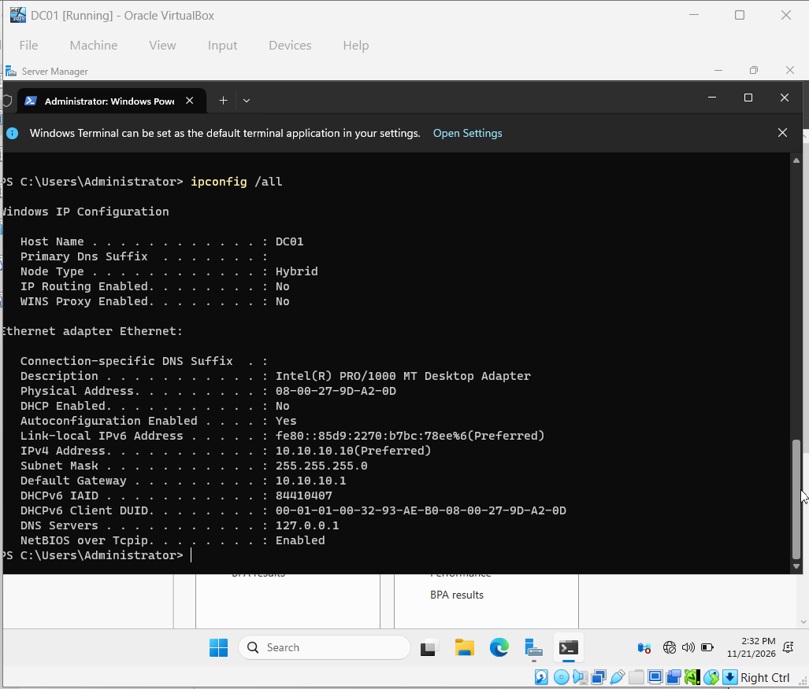
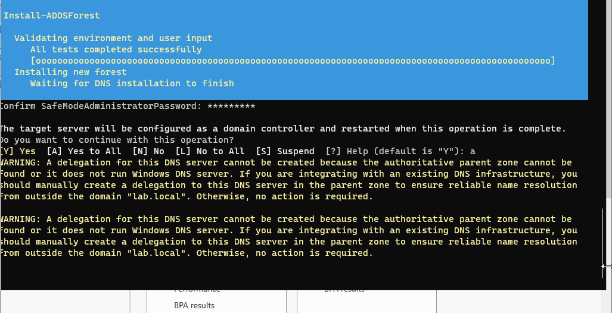
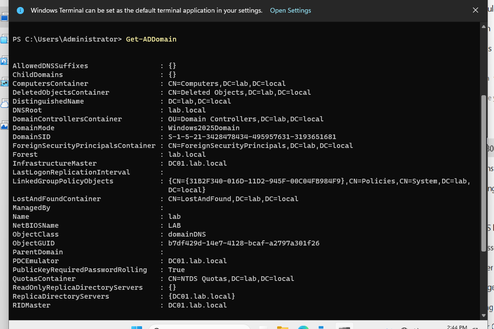
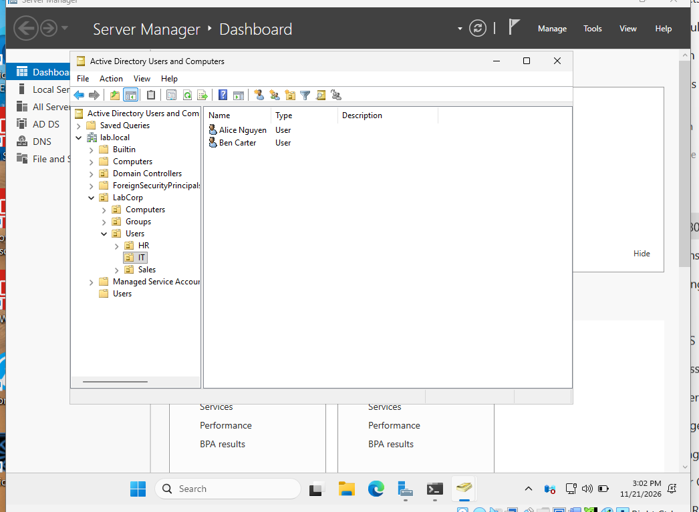
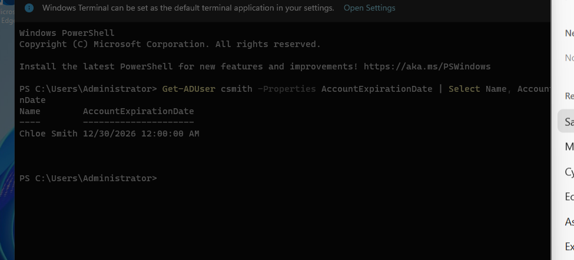

# Active Directory Lab – lab.local

Windows Server 2025 domain controller running in VirtualBox, used to practise
AD administration and common service desk tasks.

## Environment

| Item | Value |
|---|---|
| Hypervisor | VirtualBox on Windows 11 (Lenovo Legion 5) |
| Network | VirtualBox NAT Network `LabNet` – 10.10.10.0/24 |
| DC01 | Windows Server 2025 Standard Eval (Desktop Experience), 4 GB RAM, 2 vCPU, 50 GB disk |
| DC01 IP | 10.10.10.10 (static), DNS 127.0.0.1 |
| Domain | `lab.local` (NetBIOS `LAB`), functional level Windows2025Domain |

## Build steps

**1. Isolated lab network.** Created a NAT Network so lab VMs can talk to each
other and reach the internet, separate from my home network.



**2. VM and OS install.** Windows Server 2025 with Desktop Experience.



**3. Server prep.** Set the time zone (Kerberos needs accurate time), renamed to
DC01, and assigned a static IP with DNS pointing to itself.



**4. Installed AD DS and promoted to a new forest.**

```powershell
Install-WindowsFeature AD-Domain-Services -IncludeManagementTools
Install-ADDSForest -DomainName "lab.local" -DomainNetbiosName "LAB" -InstallDns
```



**5. Verified the domain** and confirmed DNS resolution works.



## Directory structure

Created a fictional company (LabCorp) with OUs, security groups and users using
a PowerShell script.

```
lab.local
└── LabCorp
    ├── Users (IT, Sales, HR)
    ├── Computers
    └── Groups (GRP-IT, GRP-Sales, GRP-HR)
```



## Service desk tasks practised

- Password resets with forced change at next logon
- Account lockout investigation and unlock
- Disabling accounts for leavers
- Moving users between departments (OU and group changes)
- Setting and clearing account expiry dates for contractors



## Lessons learned

- Group Policy can't be linked to the default Users/Computers containers, so
  users and computers belong in custom OUs.
- A domain controller needs a static IP and must use itself for DNS.
- An account set to expire "End of 29 Dec" is stored as 30 Dec 00:00, a common
  source of confusion.

## Next

- [ ] Windows 11 client (CLIENT01) joined to the domain
- [ ] Group Policy: password policy, mapped drives, desktop restrictions
